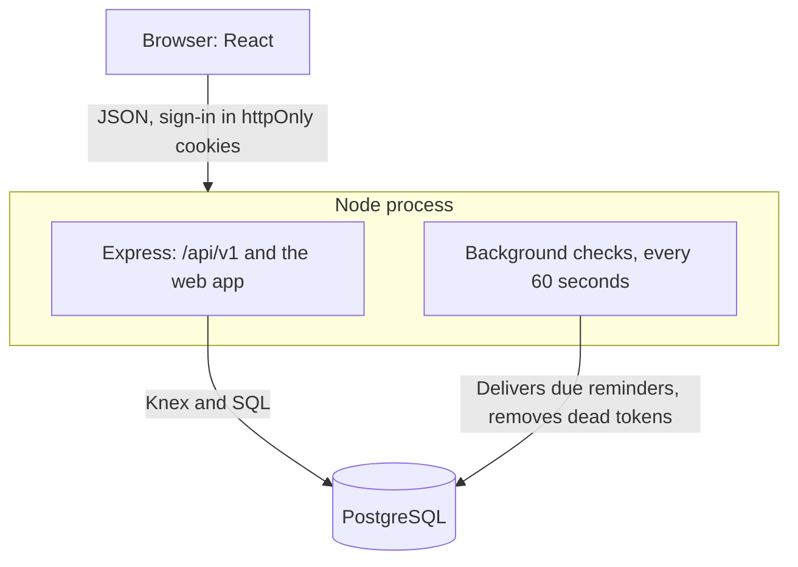

# Session Booking

When someone reaches out for mental health support, a double-booked session or a missed reminder means they don't get it. Session Booking is a full-stack app built so that doesn't happen, for members and professionals spread across timezones.

A member finds a professional, picks a time on their own clock, and books a 50-minute session. Two members can press Book at the same instant, a country can change its clocks, and the server can restart mid-delivery: the session still belongs to one member, it stays at the right time, and each reminder arrives exactly once.

**Stack:** TypeScript, React, Node, Express, PostgreSQL

## Quick start

You need Docker with Compose, and ports 3000 and 5433 free.

```bash
docker compose up
```

The app is at http://localhost:3000. To use another port:

```bash
PORT=3001 docker compose up
```

### Demo accounts

All accounts are fictional and share the password `password123`.

| Role         | Email                | Timezone            |
| ------------ | -------------------- | ------------------- |
| Member       | `sam@example.com`    | `Asia/Singapore`    |
| Member       | `alex@example.com`   | `Europe/London`     |
| Professional | `priya@example.com`  | `Asia/Kolkata`      |
| Professional | `daniel@example.com` | `Asia/Singapore`    |
| Professional | `aisha@example.com`  | `Asia/Kuala_Lumpur` |
| Professional | `emily@example.com`  | `Australia/Sydney`  |

`sam@example.com` and `priya@example.com` share a past session and one starting about 70 minutes after the first start-up, so its 1-hour reminder arrives after about 10 minutes.

Data survives restarts. To wipe it and get fresh demo data on the next start:

```bash
docker compose down -v
```

## Tests

```bash
docker compose run --rm test
```

Server tests run against a real Postgres, in a separate database, and cover the rules that are costly to get wrong:

| Guarantee                                                          | Enforced by                                                                            | Tested in                                                                                                                                      |
| ------------------------------------------------------------------ | -------------------------------------------------------------------------------------- | ---------------------------------------------------------------------------------------------------------------------------------------------- |
| A slot is booked once, and a member never has overlapping sessions | [Postgres exclusion constraints](server/src/migrations/20261105110213_sessions/up.sql) | [sessions-race](server/test/booking/sessions-race.test.ts), [sessions-clash](server/test/booking/sessions-clash.test.ts)                       |
| A move never leaves zero or two sessions                           | [One statement on one row](server/src/sessions/store.ts)                               | [sessions-reschedule](server/test/sessions/sessions-reschedule.test.ts), [race](server/test/sessions/sessions-reschedule-race.test.ts)         |
| Working hours hold across clock changes                            | [Slot builder](server/src/slots/slots.ts)                                              | [slots](server/test/slots/slots.test.ts)                                                                                                       |
| Members can't change a session within 24 hours                     | [Elapsed-time check](server/src/sessions/change-notice.ts)                             | [sessions-cancel-member](server/test/sessions/sessions-cancel-member.test.ts), [rules](server/test/sessions/sessions-reschedule-rules.test.ts) |
| Reminders follow every booking, cancel and move                    | [Written with the session change](server/src/reminders/new-reminders.ts)               | [reminders-booking](server/test/reminders/reminders-booking.test.ts)                                                                           |
| Each reminder is delivered exactly once                            | [Row locks, one commit, a unique reference](server/src/reminders/store.ts)             | [reminders-exactly-once](server/test/reminders/reminders-exactly-once.test.ts)                                                                 |
| Nobody sees another person's data                                  | Every query scoped to the signed-in user                                               | Every `*-access.test.ts`                                                                                                                       |

## Features

**Members** browse professionals, see four weeks of free slots on their own clock, book through a confirmation screen, and cancel or reschedule up to 24 hours before a session.

**Professionals** set weekly working hours on their own clock, with several ranges a day, and a minimum booking notice (2 hours by default). They see their sessions with each member's name and can cancel any of them at any time.

**Both** sign up with a timezone, see upcoming, past and cancelled sessions, and get in-app reminders 24 hours and 1 hour before each session. The other person is notified when a session is cancelled or moved.

Slots start at the beginning of each working-hours range and repeat hourly: a 50-minute session and a 10-minute gap.

### Not included

- Blocking off specific dates.
- Password reset, email verification, social login, payments, video calls, recurring sessions, external calendar sync, and real email, SMS or push.
- Rate limiting, audit logs, consent records, encryption at rest and CI. See [what production needs](DECISIONS.md#running-this-in-production).

## Architecture



Sessions are stored as UTC instants and working hours as clock times in the professional's timezone. Slots are built from the two when they're asked for, and nothing about a slot is stored until it's booked. Reminders are rows next to their session, written in the same statement as the change that creates or cancels them.

The reasoning and trade-offs are in [DECISIONS.md](DECISIONS.md). How AI tools were used is in [AI_USAGE.md](AI_USAGE.md).

```
server/
  src/
    auth/           sign-up, log-in, tokens
    booking/        booking a session and its refusals
    directory/      the list of professionals
    notifications/  the notification list
    reminders/      planning and delivering reminders
    sessions/       listing, cancelling and moving sessions
    settings/       working hours and profile
    slots/          the slot builder
    migrations/     plain SQL, one folder per migration
  test/
web/
  src/              React app, one folder per feature
```

Each server feature keeps HTTP in `routes.ts` and queries in `store.ts`.

## Configuration

Set these in the shell when starting the app, for example `DB_POOL_MAX=5 docker compose up`.

| Variable                   | Default | Description                                                                                        |
| -------------------------- | ------- | -------------------------------------------------------------------------------------------------- |
| `PORT`                     | `3000`  | Port the app is published on.                                                                      |
| `DB_POOL_MAX`              | `10`    | Most database connections per server process. Anything but a positive whole number stops start-up. |
| `BACKGROUND_CHECK_SECONDS` | `60`    | How often reminders are delivered. Anything but a positive number stops start-up.                  |

## Development

Requires Node 24 or newer. Postgres still runs in Docker.

```bash
docker compose up -d db
```

```bash
npm install
```

Run each of these in its own terminal. The web app is at http://localhost:5173.

```bash
npm run dev:server
```

```bash
npm run dev:web
```

Other commands:

| Command             | What it does                                                                     |
| ------------------- | -------------------------------------------------------------------------------- |
| `npm test`          | All tests. `TEST_DATABASE_URL` picks the database; its name must end in `_test`. |
| `npm run typecheck` | Type-checks server and web.                                                      |
| `npm run lint`      | Runs Oxlint.                                                                     |
| `npm run format`    | Runs Prettier.                                                                   |
